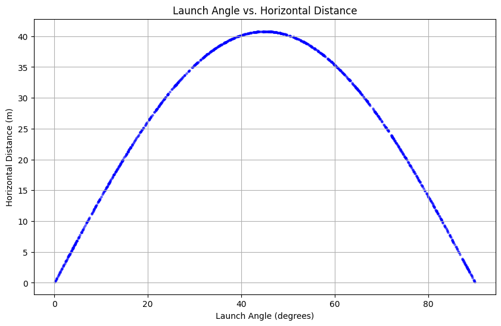
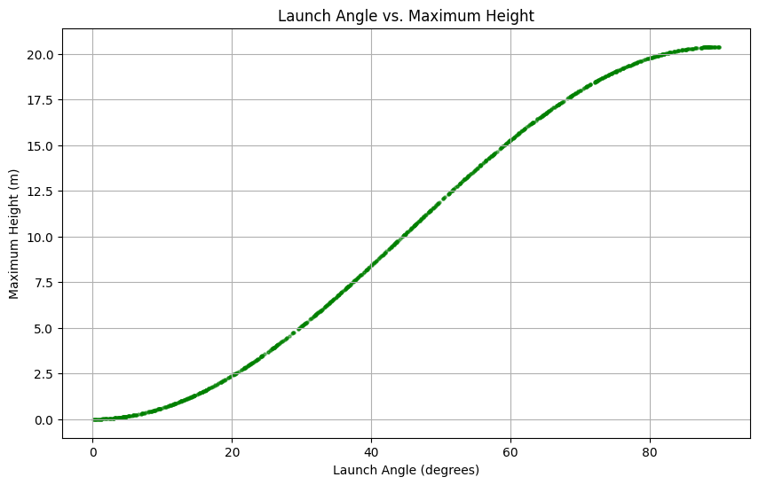

# Monte Carlo Simulation of Projectile Motion

A Python notebook that samples launch angles to explore how the horizontal range and maximum height of an ideal projectile change with angle. It uses 1,000 uniformly sampled angles between 0° and 90°, an initial speed of 20 m/s, and gravitational acceleration of 9.81 m/s².

## Model

For a launch angle θ and speed *u*, the notebook calculates:

- Time of flight: `T = 2u sin(θ) / g`
- Horizontal range: `R = u² sin(2θ) / g`
- Maximum height: `H = u² sin²(θ) / (2g)`

The model assumes level launch and landing points, constant gravity, and no air resistance. The Monte Carlo method samples angles uniformly and evaluates these analytical equations for each sample; it does not numerically integrate a trajectory or model measurement uncertainty.

## Method and results

1. Draw 1,000 random launch angles from 0° to 90° with NumPy.
2. Compute range, maximum height, and flight time for each angle.
3. Report the largest sampled range and height and their corresponding angles.
4. Plot range and height against launch angle.

The ideal maximum range is `u²/g ≈ 40.77 m` at **45°**. The largest possible height is `u²/(2g) ≈ 20.39 m` at **90°**. The notebook prints the maxima among its sampled angles, so the reported angles and values change slightly on each run. In the saved run, the maximum sampled range was about 40.77 m near 45.04°, and the maximum sampled height was about 20.39 m near 89.88°.





## Run the notebook

Open [`projectile_motion_monte_carlo.ipynb`](projectile_motion_monte_carlo.ipynb) in Google Colab or Jupyter and run its single code cell. For a local Python environment:

```bash
python -m pip install -r requirements.txt
jupyter notebook projectile_motion_monte_carlo.ipynb
```

A Jupyter installation is needed for the local notebook command. Google Colab already provides the required numerical and plotting libraries. The notebook uses an unseeded random generator, so each execution produces a different sample.

## Files

- `projectile_motion_monte_carlo.ipynb` — original simulation code and saved output
- `figures/` — the two plots from the saved notebook run
- `requirements.txt` — Python libraries used by the notebook
